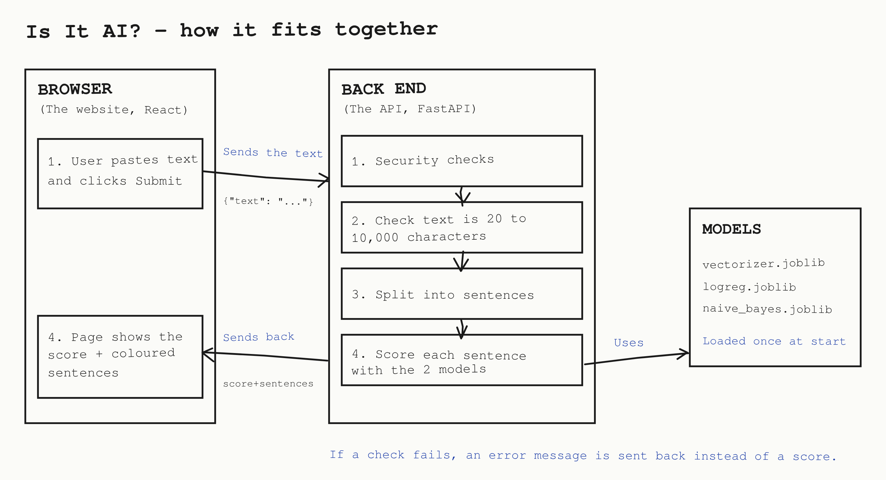

# AI Detector Web Page Development Project
Session 4, Group 4: Amanuial Ashagrie, Lloyd Cook-Rowe, Nathan Alexander Vuong

This project is a web application that estimates the likelihood of any given piece of text being AI-Generated and provides the user with a percentage estimate that the content is AI. Each sentence is highlighted a different coloured based on the programs estimation of the AI usage for that sentence.
 The machine learning models used to make the predictions were trained on our Assignment 2 from the DAIGT kaggle datasets (Kłeczek, 2023, https://www.kaggle.com/datasets/thedrcat/daigt-v3-train-dataset).


## Setup and Run Instructions
To run the full website you will need two terminals, one for the front end and one for the backend.
### 1. Prerequisites
Python 3.12 or newer,

Node.js 22.12 or newer,

recent Git version

### 2. Setup Environment
In a new terminal insert the below:
```bash
git clone https://github.com/aman-ashagrie/AI-Detector-Web-Page-Developemnt.git
cd AI-Detector-Web-Page-Developemnt
```
To install the required libraries, use the below code block:
```bash
cd backend
python -m venv venv
.\venv\Scripts\Activate.ps1
pip install -r requirements.txt
```
Once that has successfully run, and your terminal line has (venv) at the start, you can startup the frontend server.

If you want to test the health of the site, you can access it at:
- http://127.0.0.1:8000/api/health

To view the API documentation use the link:
- http://127.0.0.1:8000/docs


### 3. Launching Backend and Frontend
You will already be inside the backend folder so simply type:
```bash
python main.py
```
Once the terminal displays:
```bash
INFO:     Application startup complete.
```
You can open a second terminal window and startup the frontend website using the below:
```bash
cd frontend
npm ci
npm run dev
```
Open http://localhost:5173. Paste at least 20 characters of text and press Submit to test that both the backend and frontend are responsive. The overall AI likelihood and per-sentence highlighting should appear with no error messages.

## Architecture diagram



**How a request flows.** The user pastes text into the Check page and presses Submit. The React front end sends it to the FastAPI back end as a POST request to `/api/analyse/`. The back end runs its security checks, validates the text length, splits the text into sentences and scores each one with the saved models. It then sends the overall score and the score for each sentence back to the frontend page, which displays them visually to the user.

**Where validation and errors are handled.** The front end limits the text to 10,000 characters.
The back end enforces its own limits, because attackers skip the interface: the middleware rejects
oversized bodies, Pydantic rejects invalid text, and the concurrency slot rejects excess load. Every
error, including unexpected ones, leaves the back end as `{"error": {"code": ..., "message": ...}}`
with no stack trace.

**The model.** This is the Assignment 2 model. Text is cleaned (Unicode normalisation, URLs, e-mail
addresses, HTML tags and control characters removed) and split into sentences. Each sentence is
scored by logistic regression and multinomial Naive Bayes on TF-IDF features, and the two
probabilities are averaged. The overall score is the mean of the sentence scores (0 = human,
100 = AI).

## Pinned Dependencies
Backend:
| Dependency | Version |
|---|---|
| fastapi | 0.141.1 |
| starlette | 1.6.0 |
| pydantic | 2.13.4 |
| uvicorn | 0.52.1 |
| joblib | 1.6.0 |
| scikit-learn | 1.9.1 |
| numpy | 2.5.2 |
| scipy | 1.18.1 |
| requests | 2.34.2 |

Frontend: (frontend/package.json and frontend/package-lock.json)

These files ensure the package versioned is locked and installed on startup.
| Dependency | Version |
|---|---|
| react, react-dom | ^19.2.8 |
| react-router-dom | ^7.18.4 |
| axios	| ^1.21.0 |
| chart.js | ^4.6.1 |
| react-chartjs-2 | ^5.3.1 |
| vite (dev) | ^8.3.0 |

## Threat Model

**Who would attack it?**
1. A student, or a "humaniser" service, that wants AI-generated text to be judged human-written.
2. Someone who wants to take the service down, so it can't be used to check their work.

**What are they trying to achieve?**
To make the detector unavailable or slow for real users, to find out how it makes decisions by probing it repeatedly, or to learn about our server from its error messages and headers.

**What can they actually do?**
Attackers don't use our interface. They can send requests straight to the API with curl or scripts, so any front-end check can be bypassed. They can send very large text, text crafted to make our cleaning code slow, or hundreds of requests at once. They can also scan the server for missing security headers, leaked versions and vulnerable dependencies.

**Which risks our design exposes:**

## References
Kłeczek, D. (2023) DAIGT V3 train dataset. Kaggle. Available at: [https://www.kaggle.com/datasets/thedrcat/daigt-v3-train-dataset] (Accessed 5/08/2026)

GitHub (2026) *GHSA-g3hv-75wg-m249: minimatch has potential denial of service via globparts amplification*. Available at: https://github.com/advisories/GHSA-g3hv-75wg-m249 (Accessed: 9 November 2026).

OWASP Foundation (2026) *Regular expression Denial of Service – ReDoS*. Available at: https://owasp.org/www-community/attacks/Regular_expression_Denial_of_Service_-_ReDoS (Accessed: 9 November 2026).

